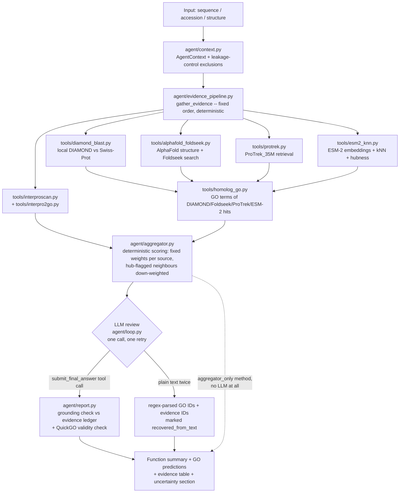

# Protein Function Agent

An LLM agent that infers a protein's function by orchestrating multiple bioinformatics tools, built as a prototype following a suggestion from Prof. Fajie Yuan (Westlake University, author of SaProt / ProTrek / Pinal / Evolla) to try building an AI agent for this task. Everything runs on a normal CPU laptop -- no GPU is used anywhere.

Given a protein (sequence, optionally a UniProt accession, or a structure), the agent produces:
- a function summary,
- predicted GO (Gene Ontology) terms with confidence scores,
- an **evidence table** -- every claim traces back to a specific tool call, its raw score, and a source link,
- a disagreement/uncertainty section when tools point different ways.

## What it does, in one paragraph

Rather than letting an LLM free-form call tools (which turned out to be unreliable -- see "Why the deterministic pipeline" below), the agent first gathers evidence **deterministically** from every tool in a fixed order, then **scores** every candidate GO term with a fixed, documented weighting rule, and only then gives the LLM one review pass over the already-scored candidates (accept, reject, re-weight -- always citing an evidence ID) to write the final summary. This means the deterministic scoring step (`aggregator_only`) is itself a usable, LLM-free method, and the LLM's contribution can be measured on top of it rather than assumed.

## Architecture



## Tools, with licenses (full detail in `docs/TOOLS.md`)

| # | Tool | What for | License / terms |
|---|---|---|---|
| 1 | UniProt REST API | Ground truth + sequence fetch | CC BY 4.0 |
| 2 | QuickGO REST API | GO term validity, ancestors | Free for all use (EBI) |
| 3 | InterProScan (EBI Job Dispatcher) + `interpro2go` mapping | Domain/family detection, domain→GO | EBI terms of use |
| 4 | AlphaFold DB + Foldseek web search | Structure fetch + structural homology search | CC BY 4.0 (AlphaFold DB); free, non-commercial research (Foldseek web) |
| 5 | Local DIAMOND vs Swiss-Prot | Sequence homology search | DIAMOND: GPL; Swiss-Prot data: CC BY 4.0 |
| 6 | ProTrek_35M (westlake-repl) | Sequence/structure → text retrieval | MIT |
| 7 | ESM-2 (35M) | Embeddings + kNN + hubness diagnostic | Meta/FAIR ESM license |
| 8 | PubMed E-utilities | Literature (lowest priority) | Not yet implemented |

UniProt (#1) is excluded from the agent's own tool list in evaluation mode, since it is also where ground truth comes from.

## Why a deterministic pipeline instead of free-form tool calling

The first design let the LLM (qwen3:8b, local via Ollama, CPU-only) decide which tools to call and when. Two problems showed up on the first real evaluation run (20-protein dev set, see "Superseded" section of `docs/RESULTS.md`):
1. The model wrote a plain-text final answer instead of calling the submit tool on 30% of proteins.
2. Even when it did call tools correctly, its own DIAMOND/Foldseek calls returned only hit accessions and identity scores -- never the hits' own GO annotations -- so the agent had strictly *less* evidence available than the simple "look up top hit's GO terms" baseline it was being compared against.

Both are structural, not prompting issues, so the fix was architectural: evidence gathering and GO-term scoring no longer depend on the LLM making the right tool-calling decisions every time (`agent/evidence_pipeline.py`, `agent/aggregator.py`). The LLM's job narrows to reviewing already-assembled, already-scored evidence and writing the explanation -- with a documented fallback (regex-based parsing, flagged `recovered_from_text`) if it still doesn't use the structured submit call. Full root-cause writeup: `docs/RESULTS.md`'s "Superseded" section and `eval/README.md`'s "The root-cause fix" section.

## Leakage control

For evaluation, the agent must not be able to simply look up the answer. For every query protein, `agent/context.py`'s `AgentContext.build_exclusions()` runs DIAMOND once and builds an exclusion set = {the query's own accession} ∪ {every hit at ≥50% identity}. This set is passed into every retrieval tool (DIAMOND, Foldseek, ProTrek, ESM-2, and the GO-annotation lookups on their hits) whenever `eval_mode=True`, so no close homolog's annotation can leak into the "prediction". Full detail: `eval/README.md`'s "Leakage control" section.

## How to run it on one protein

```bash
python3 -m venv .venv && source .venv/bin/activate
pip install -r requirements.txt
# .env needs: LLM base_url/api_key/model (OpenAI-compatible), EBI_CONTACT_EMAIL

# by UniProt accession (sequence fetched automatically)
python -m agent.run --accession P04637

# by raw sequence
python -m agent.run --sequence MEEPQSDPSV...

# evaluation mode (excludes the query + close homologs from retrieval, for benchmarking)
python -m agent.run --accession P04637 --eval-mode
```

Output is printed and the full trace (evidence ledger, aggregator candidates, LLM review) is saved under `runs/<protein>/<timestamp>/`.

## Evaluation

Full methodology (dev set vs. held-out test set, leakage control, scoring, hubness diagnostic with significance testing) is in `eval/README.md`. Results are in `docs/RESULTS.md`.

### Status: preliminary results (re-evaluation in progress)

Full numbers, methodology, and an honest account of two pipeline bugs found and fixed mid-run (EBI API rate-limiting silently zeroing out results; a hubness-diagnostic context bug on resumed runs) are in `docs/RESULTS.md`. Headline results, direct-match | CAFA-propagated Fmax:

Note: `aggregator_only` and `full_agent` were evaluated on a 17-protein subset, while the three baselines ran on all 57 proteins, so these rows are not directly comparable. In this run, ProTrek evidence was also missing inside the agent pipeline because of an environment error (`protrek_transfer` itself ran correctly). A same-set re-evaluation with ProTrek fixed is in progress.

| Method (n) | molecular_function | biological_process | cellular_component |
|---|---|---|---|
| `diamond_transfer` (57) | 0.358 \| 0.526 | 0.261 \| 0.348 | 0.332 \| 0.420 |
| `protrek_transfer` (57) | 0.241 \| 0.327 | 0.140 \| 0.281 | 0.517 \| 0.625 |
| `llm_no_tools` (57) | 0.031 \| 0.117 | 0.000 \| 0.058 | 0.077 \| 0.173 |
| `aggregator_only` (17) | 0.268 \| 0.284 | 0.169 \| 0.125 | 0.379 \| 0.398 |
| `full_agent` (17) | 0.130 \| 0.153 | 0.100 \| 0.102 | 0.262 \| 0.248 |

On this 17-protein subset, the deterministic `aggregator_only` method beats `full_agent` (the LLM review step) on every aspect, but this is preliminary -- the LLM review currently narrows results rather than improving them, a genuine negative result reported as found, not smoothed over, though it needs the same-set re-evaluation above to confirm. The hubness diagnostic is now statistically significant (p=0.0202, Fisher exact test, n=570 neighbours): hub-flagged ESM-2 neighbours hit at 11.1% vs. 27.4% for non-hub ones, supporting the aggregator's down-weighting of hub-flagged evidence.

## Repository layout

```
agent/       -- agent loop, evidence pipeline, deterministic aggregator, report builder
tools/       -- one file per external tool, each returning a standard Evidence object
eval/        -- benchmark sets, leakage control, baselines, metrics, held-out test set
docs/        -- TOOLS.md, RESULTS.md (this README covers architecture)
runs/        -- full trace of every run (<protein>/<timestamp>/) (local only, not committed)
tests/       -- unit tests, with real-call fixtures under tests/fixtures/
```

## Limitations (honest, as of this writing)

- CPU-only, local 8B-parameter LLM (qwen3:8b via Ollama) -- slower and less reliable at structured tool-calling than a larger hosted model.
- The held-out test set (57 proteins) is a bounded sample (built from a bounded QuickGO scan), not a full census of experimentally-annotated Swiss-Prot entries -- documented in `eval/README.md`.
- `full_agent` costs several minutes per protein on this hardware; see `docs/RESULTS.md` for whether the overnight run reached all 57 proteins or had to stop partway (checkpointed and resumable either way).
